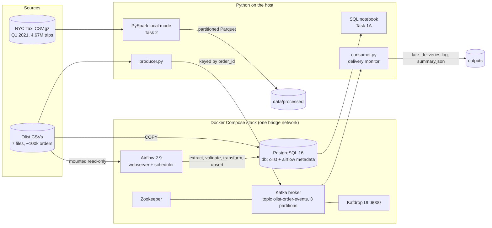

# Architecture

## How the pieces fit

| Component | Role in this project | Why this tool |
|---|---|---|
| PostgreSQL | System of record for orders; target of the ETL mart | ACID transactions and joins for transactional data; mature indexing (Task 1A) |
| MongoDB (design) | Product catalogue and clickstream | Flexible, read-optimised documents for high-volume semi-structured data (Task 1B) |
| PySpark | Batch analytics over millions of trips | Parallel, lazy, partition-aware processing that scales from laptop to cluster (Task 2) |
| Docker Compose | Runs every service with one command | Same versions and config on any machine; nothing installed by hand (Task 3A) |
| Airflow | Orchestrates the nightly ETL | Dependencies, retries, schedule and logs in one place (Task 3B) |
| Kafka + Kafdrop | Real-time order event stream | Durable, replayable log; consumers can fall behind and catch up (Task 3C) |

**Batch and streaming side by side.** Airflow answers "how did each state perform last month?" once a day from the full history. Kafka answers "which order just arrived late?" within a second of the event. Both read the same Olist data and both drop customer identifiers, so the reporting layer never holds personal data.

**Scaling path.** Each piece scales independently: Spark from `local[*]` to a cluster by changing the master URL, Kafka by adding partitions and brokers (the consumer group already supports parallel consumers), and Airflow from LocalExecutor to Celery or Kubernetes executors.
